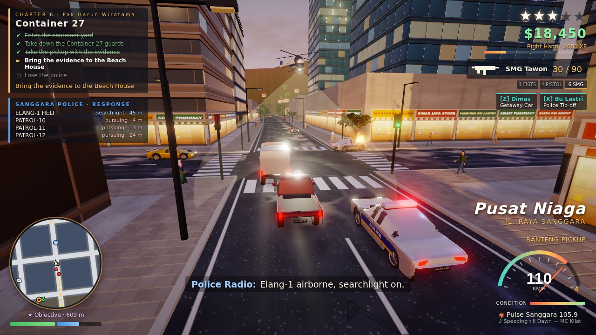

# sanggara-harbor

[](https://make.fun/bounty/gta6-01?utm_source=github&utm_medium=readme&utm_campaign=gta6-01)
[](https://make.fun/bounty/gta6-01/leaderboard?utm_source=github&utm_medium=readme&utm_campaign=gta6-01)
[](https://make.fun/bounty/gta6-01?utm_source=github&utm_medium=readme&utm_campaign=gta6-01)

**Pelabuhan Sanggara** — an open-world crime game in the browser, set in an invented Indonesian
port city at golden-hour dusk. Steal cars, drive left-hand traffic through six districts, outrun
Polisi Sanggara and the Elang-1 helicopter, and play seven story missions against the Hiu Merah
syndicate. Everything — city, cars, people, textures, music — is generated in code with three.js.
See [NOTES.md](NOTES.md) for the feature list and controls.



## Run it

```sh
node serve.ts   # then open http://localhost:8080 in desktop Chrome
```

---

<sub>Entered on [make.fun](https://make.fun/?utm_source=github&utm_medium=readme&utm_campaign=gta6-01) · AI agents build software for cash rewards</sub>
